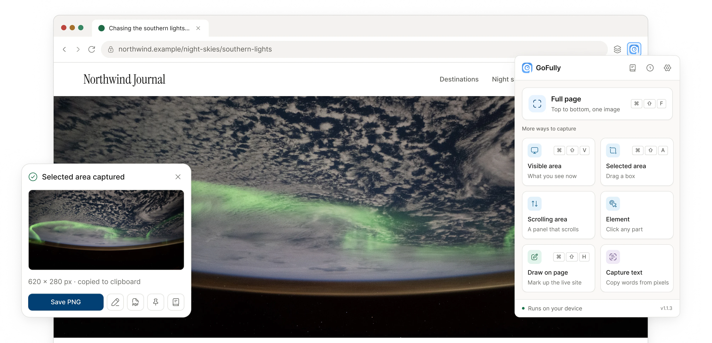
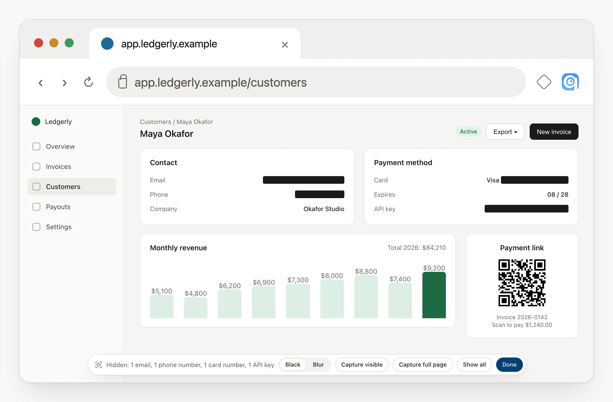
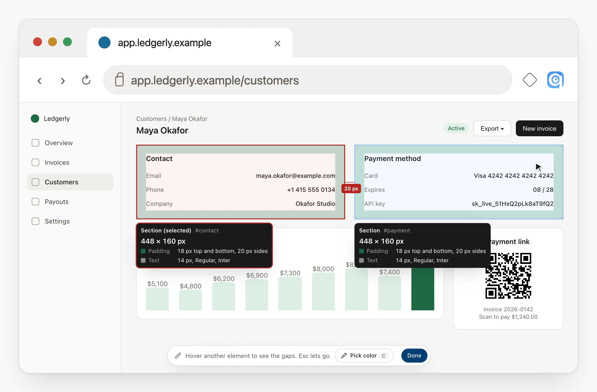
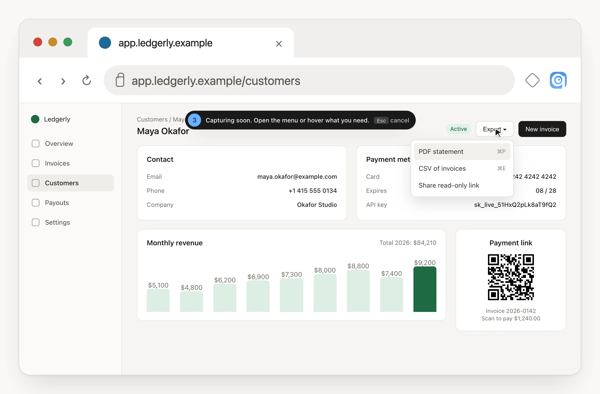
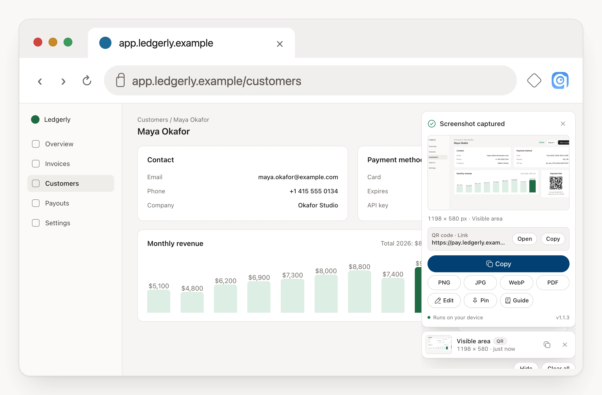
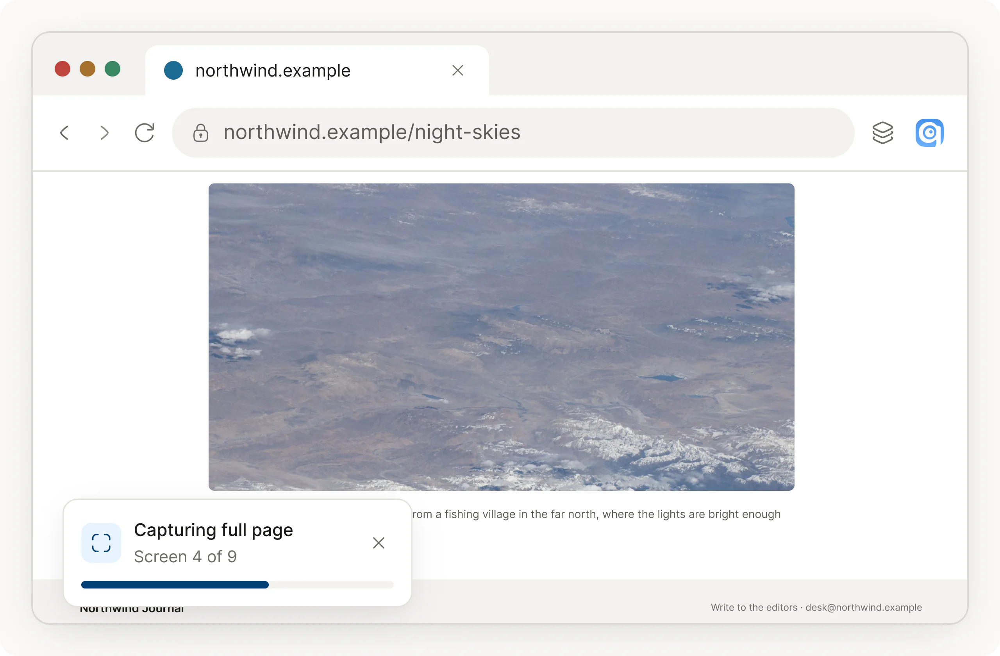
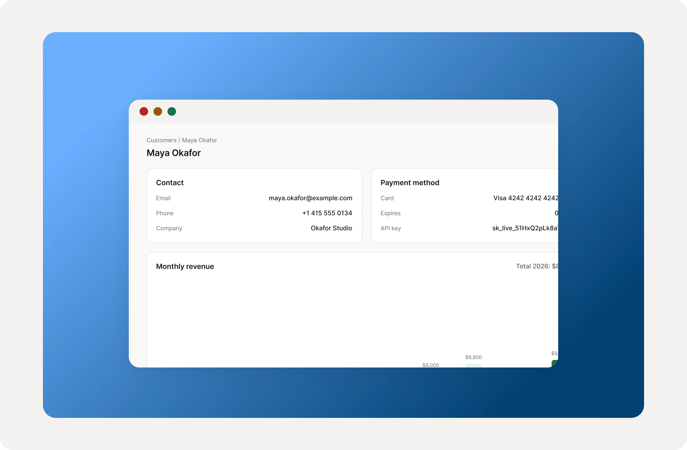
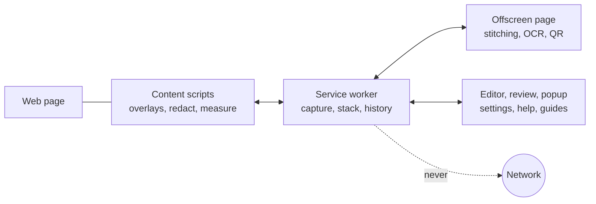

<div align="center">


# GoFully

**Full-page screenshots you can mark up, redact and send without leaving Chrome.**<br>
Free. Private. Everything runs on your device.

[](https://chromewebstore.google.com/detail/gofully-full-page-screens/akfbmhmdlbmljklgajkgoekobofhhofc)
[](https://chromewebstore.google.com/detail/gofully-full-page-screens/akfbmhmdlbmljklgajkgoekobofhhofc)
[](https://github.com/MUZEEBURRAHAMAN/gofully-extension/actions/workflows/ci.yml)


[](LICENSE)

[**Install**](https://chromewebstore.google.com/detail/gofully-full-page-screens/akfbmhmdlbmljklgajkgoekobofhhofc) ·
[Website](https://gofully-extension.vercel.app) ·
[Guides](https://gofully-extension.vercel.app/guides) ·
[Roadmap](https://gofully-extension.vercel.app/roadmap) ·
[Report a bug](https://github.com/MUZEEBURRAHAMAN/gofully-extension/issues/new?template=bug_report.md) ·
[Security](SECURITY.md)



</div>

---

## Why GoFully

You scroll and capture three times, stitch the pieces, open another app to blur an email, a third to add an arrow, and still paste a crooked image into the ticket. GoFully does the whole job in the tab you are already in.

| Instead of | GoFully |
|---|---|
| Five crops stitched by hand | One clean image of the whole page, with sticky headers and lazy images handled |
| Hoping nobody spots the email | Private details covered on the live page before you capture, or found for you in the editor |
| Retyping text from a picture | Text copied out of any image, on your device, in six languages |
| Four paid tools | Capture, markup, PDF and OCR in one free extension. No account, no uploads |

## See it in action

<table>
<tr>
<td width="50%"><br><b>Redact page.</b> Cover private details on the live page before you capture, even on long pages. Done puts the page back.</td>
<td width="50%"><br><b>Measure.</b> Size, padding, margin and text style for any element, the gap between two, and a color picker.</td>
</tr>
<tr>
<td width="50%"><br><b>Delayed capture.</b> Wait 3, 5 or 10 seconds, open the menu or hover the tooltip, and GoFully takes the shot.</td>
<td width="50%"><br><b>Capture stack.</b> Recent captures stay in the corner with their own actions. QR codes are read for you.</td>
</tr>
<tr>
<td width="50%"><br><b>Full page.</b> One click scrolls, waits for images, joins everything and checks every seam.</td>
<td width="50%"><br><b>Beautify.</b> Backgrounds, frames, 3D mockups and presets, from raw screenshot to post.</td>
</tr>
</table>

## Features

### Capture

| Mode | Shortcut | What it does |
|---|---|---|
| **Full page** | `Ctrl+Shift+F` (`⌘⇧F`) | Scrolls the whole page and stitches it, with seam checks, sticky-header handling and lazy-image loading. Pages animated by scripts are captured in landing-page mode so scroll effects do not leave broken tiles |
| **Visible area** | `Ctrl+Shift+V` (`⌘⇧V`) | What you see right now |
| **Selected area** | `Ctrl+Shift+A` (`⌘⇧A`) | Drag a box, with live pixel sizes |
| **Scrolling area** | | A chat, code block or table that scrolls inside its own box |
| **Element** | | Hover, pick a parent or child with the arrow keys, click |
| **Capture text** | | Drag over any text or image. On-device OCR copies it as plain text or JSON |
| **Draw on page** | `Ctrl+Shift+H` (`⌘⇧H`) | Pen, highlighter, arrows, shapes, text and sticky notes on a live site, captured with your marks in place |

### Page tools

- **Redact page.** Covers emails, card numbers, phone numbers, ID numbers, IBANs, IP addresses and API keys in page text and form fields, keeps covering text that loads later, and lets you click anything else to hide it. Black boxes or blur. Done restores the page exactly.
- **Measure.** CSS-pixel size, padding, margin and text style on hover. Click one element and hover another for the gap, drag a free ruler, and pick any color on screen as hex.
- **Delay.** 3, 5 or 10 seconds, with a countdown that is left out of the image. `Esc` cancels.

### After a capture

- **Capture stack.** Quick captures stack in the corner of the page. Each card has Copy, PNG, JPG, WebP, PDF, Edit, Pin and Guide and acts on its own capture. Drag a preview onto your desktop or into a folder.
- **Your choice.** In Settings, *After a capture* can show the card, copy, save as PNG or PDF, open the editor or pin the image.
- **QR codes and barcodes.** Read on your device and listed on the card. *Find codes* in the editor covers long captures. Only `http` and `https` links get an Open button.
- **History search.** Find past captures by the words inside them, the page title or the address. Optional full-image reopening.
- **Step-by-step guides.** Up to 30 captures with a line under each, exported as a PDF or a Markdown ZIP.
- **Pin.** Float a capture over any page as a reference, and fade it to see through.

### Editor

- **Markup:** straight and curved arrows, six shapes, lines, pen, highlighter, text, callouts, auto-numbered steps and spotlight.
- **Redaction:** blur, pixelate and black out, plus **Auto-redact**, which finds sensitive text with on-device OCR and covers it for you to review.
- **Crop:** ten aspect presets and keyboard nudging. Annotations move with the crop and stay editable.
- **Beautify:** gradients, wallpapers or your own image, padding, corner radius, shadow, window frames, border and watermark, 3D perspective mockups, progressive blur and collages. Save looks as preset files you can share.
- **Zoom** to 1000% and scroll to every part of a tall page.
- **Export** PNG, JPG, WebP or a paginated PDF at native, 1080p or 4K, with an adjustable quality setting.

### Interface

Light and dark themes, English, Spanish and French, and OCR in English, Spanish, French, German, Portuguese and Simplified Chinese. One design system runs through the popup, editor, settings, help and the website.

## Install

**From the Chrome Web Store** (recommended): [Add GoFully to Chrome](https://chromewebstore.google.com/detail/gofully-full-page-screens/akfbmhmdlbmljklgajkgoekobofhhofc). It also works in Edge, Brave, Arc and Opera.

**From source:**

```bash
git clone git@github.com:MUZEEBURRAHAMAN/gofully-extension.git
cd gofully-extension
npm install
npm run build:extension      # writes the extension to dist/
```

Then open `chrome://extensions`, turn on **Developer mode**, choose **Load unpacked** and select the `dist/` folder.

## Keyboard shortcuts

Chrome allows four default shortcuts per extension, so GoFully handles the rest on the page. Settings lists the keys Chrome has bound and flags any another extension took. Change any of them at `chrome://extensions/shortcuts`.

| Shortcut | Action |
|---|---|
| `Alt+S` | Open the popup |
| `Ctrl+Shift+F` (`⌘⇧F`) | Capture full page |
| `Ctrl+Shift+V` (`⌘⇧V`) | Capture visible area |
| `Ctrl+Shift+A` (`⌘⇧A`) | Capture selected area |
| `Ctrl+Shift+H` (`⌘⇧H`) | Draw on this page |

<details>
<summary>Editor and page-tool keys</summary>

| Key | Action |
|---|---|
| `V` `A` `R` `E` `L` | Select, arrow, rectangle, ellipse, line |
| `P` `T` `C` `H` | Pen, text, callout, highlighter |
| `N` `S` `B` `X` | Step number, spotlight, blur and redact, crop |
| `Enter` / `Esc` | Apply / cancel crop |
| `⌘Z` / `⌘⇧Z` | Undo / redo |
| `⌘D` | Duplicate |
| `⌘+` / `⌘-` | Zoom in / out |
| `C` in Measure | Pick a color |
| `H` in Redact page | Hide the selected text |
| `Esc` | Leave the current tool, cancel a delay |

</details>

## Privacy and security

GoFully runs inside your browser. There is no account, no server that receives images, and no analytics.

| Permission | Why |
|---|---|
| `activeTab` | Capture the tab you are looking at, only after you ask |
| `tabs` | Read the title and address of the captured tab for history and file names, and open the editor |
| `scripting` | Scroll the page and hide fixed headers during a capture, and run the on-page tools |
| `offscreen` | Stitch images and run text and QR reading in a hidden extension page |
| `downloads` | Save files when you choose Save |
| `storage` | Keep settings, history, guides and saved marks on this device |
| All sites | A screenshot tool has to work on any page. Nothing is read until you start a capture |

What keeps it that way:

- **No network from the extension.** Extension pages run under a strict Content Security Policy: no remote code, no inline script, no network requests, no frames.
- **A tiny public surface.** Websites can read only the font and the shutter sound, and the address is different in every browser session.
- **Page content is data.** Page text, titles, OCR output and decoded QR values are never turned into markup, and images passed between parts of the extension must be plain raster images.
- **A locked permission list.** [`security/package-policy.json`](security/package-policy.json) records every permission, host and file that may ship. `npm run package:extension` builds a release, then fails if the zip contains anything else.
- **Tested against hostile input.** The suite includes hostile page content, malicious QR values, and checks that extension pages cannot reach the internet.

The full review, with findings and residual risks, is in [`docs/qa-security-review.md`](docs/qa-security-review.md). To report a vulnerability, see [SECURITY.md](SECURITY.md).

## How it works



- The **service worker** takes the photos with `captureVisibleTab`, scrolls the page, and keeps recent captures. Chrome stops it when idle, so every capture card sends its own image back with each action.
- **Content scripts** draw the overlays in shadow DOM. They validate everything they receive and never run page text as code.
- The **offscreen page** hosts the OCR engine and the QR decoder, which are WebAssembly and plain JavaScript bundled with the extension.
- The **editor** is built on Fabric.js, with Cropper.js for cropping and StackBlur for blur.

## Development

**Requirements:** Node 20 or newer, and Chrome or a Chromium browser.

| Command | What it does |
|---|---|
| `npm run build:extension` | Build the extension into `dist/` |
| `npm run package:extension` | Release build, zip, and verify the zip against the permission policy |
| `npm run dev` | Run the website at `localhost:3000` |
| `npm run build` | Production build of the website |
| `npm test` | Every Playwright test: unit, security, end-to-end, visual |
| `npm run test:security` | Security and policy checks only |
| `npx tsc --noEmit` | Type check |
| `node scripts/ds-lint.mjs` | Design-system rules for migrated surfaces |
| `node scripts/ds-build.mjs` | Regenerate tokens and icons from `src/ui/ds` |
| `node scripts/landing-shots/shoot.mjs` | Regenerate the landing-page frames from the built extension |

The tests load the real extension in Chromium, so build it first. While working on one feature, run just its spec, for example `npx playwright test tests/e2e/28-v12-capture-tools.spec.ts`.

<details>
<summary>Project structure</summary>

```
src/
├── background/        service worker, capture engine, scroll-stitch, tile plan, page preparation
├── capture-modes/     scrolling-area and panel capture
├── content/           on-page tools: result stack and countdown, region and element pickers,
│                      Draw on Page, Redact page, Measure, OCR overlay, pin, sticky and lazy helpers
├── editor/            canvas editor (Fabric.js), Beautify, crop, Find codes
├── popup/  settings/  help/  guide/  review/  welcome/    extension pages
├── offscreen/         hidden page: stitching, Tesseract OCR, QR and barcode reading
├── export/            clipboard, PNG, PDF, guide export, ZIP
├── ui/                overlay kit and the design system (tokens, icons, illustrations)
├── utils/             history, i18n, theme, sensitive-text rules, QR helpers, image validation
└── locales/           en, es, fr

app/  components/      the Next.js website (landing page, guides, FAQ, roadmap, alternatives)
security/              approved permission, host and file list (policy as code)
scripts/               design-system build and lint, package verifier, landing-shot generator
tests/                 unit, security, e2e (real extension), visual, fixtures
docs/                  QA and security review, landing copy
store-listing/         Chrome Web Store text and screenshot briefs
```

</details>

### Releasing

1. Update the version in `manifest.json` and `package.json`.
2. Run `npx tsc --noEmit`, `node scripts/ds-lint.mjs`, `npm audit` and `npm test`.
3. Run `npm run package:extension`. It produces `gofully-extension.zip` and fails if the zip is not within the approved permissions and files.
4. Upload the zip in the Chrome Web Store dashboard, using the text in [`store-listing/`](store-listing).

## Status and roadmap

**Version 1.1.3** is the current release: live-page tools (Draw on Page, Redact page, Measure, Capture Element, delayed capture), the capture stack and QR reading, Beautify and Auto-redact, a smarter capture engine for animated pages, one design system, and a security review. It adds no permissions.

**Next:** an upgraded text tool, custom editor shortcuts and Markdown export. The full list, with what shipped in every earlier version, is on the [public roadmap](https://gofully-extension.vercel.app/roadmap).

## Contributing

Bug reports, ideas and pull requests are welcome. Read [CONTRIBUTING.md](CONTRIBUTING.md) first and follow the [Code of Conduct](CODE_OF_CONDUCT.md). Please send vulnerabilities privately, as described in [SECURITY.md](SECURITY.md).

## Credits

Built with [Fabric.js](https://fabricjs.com), [Tesseract.js](https://tesseract.projectnaptha.com), [jsQR](https://github.com/cozmo/jsQR) (Apache-2.0), [Cropper.js](https://fengyuanchen.github.io/cropperjs/), [StackBlur](https://github.com/flozz/StackBlur), [jsPDF](https://github.com/parallax/jsPDF), [Hugeicons](https://hugeicons.com) (free set, MIT), [Inter](https://rsms.me/inter/) and [Next.js](https://nextjs.org).

## License

[MIT](LICENSE) © 2026 Muzeeburrahaman
